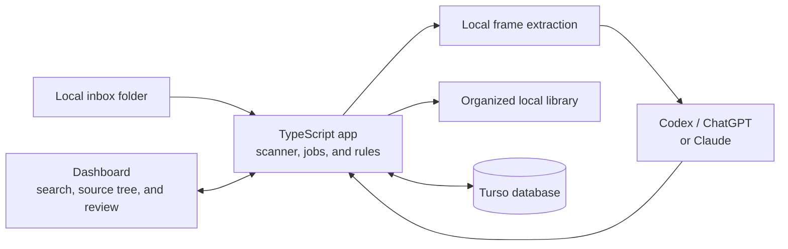
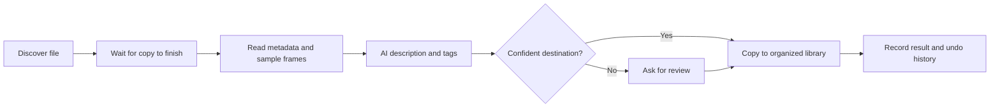
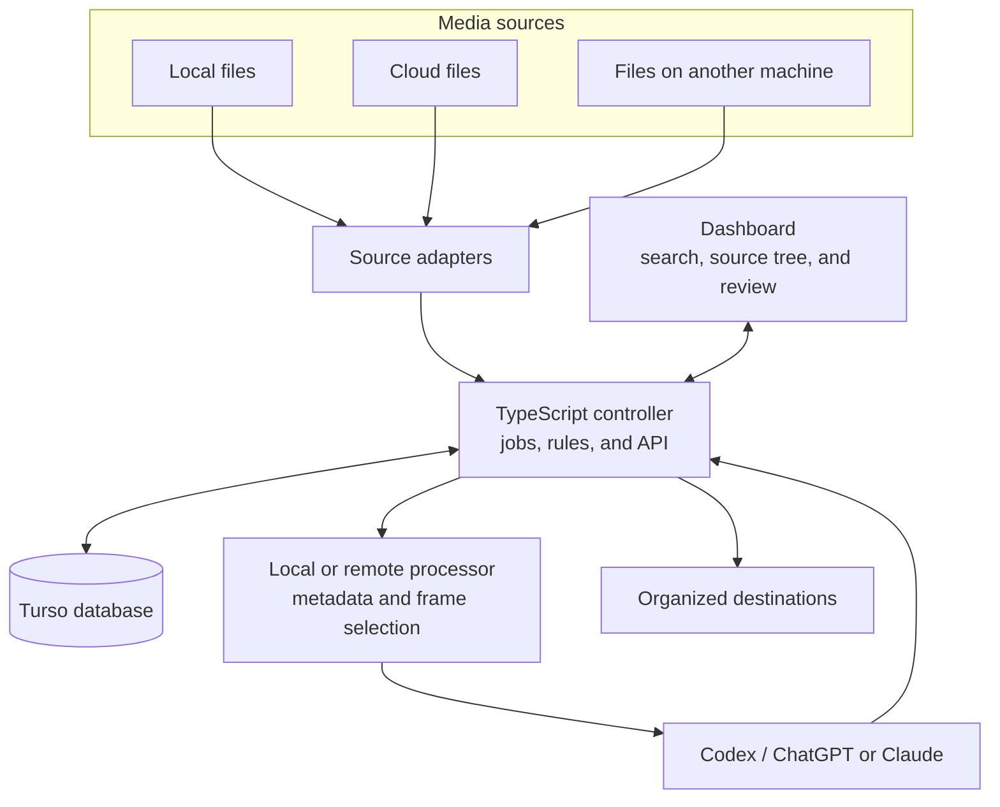

# ShotHarbor

> Project proposal and roadmap. The application described here has not been implemented yet.

ShotHarbor is a source-available, local-first tool for people who come home with footage spread across cameras, drones, phones, and drives. Drop photos and videos into an inbox; the app discovers them, examines representative frames, describes their contents, and proposes where they belong. A small dashboard shows progress, storage use, searchable tags, a file tree, and anything that needs a human decision.

Original media stays on storage you control. The initial design runs on one computer and can use an internet connection to analyze selected images through a supported ChatGPT/Codex or Claude subscription. Later versions may connect to cloud storage and delegate processing to other computers.

## The problem

Camera files arrive with names such as `GX010024.MP4` or `DJI_0037.MOV`. Dates and camera names help, but they do not tell you whether a clip contains a coastline, a cycling sequence, or an indoor interview. Reviewing every file and building folders by hand takes time, especially when a shoot combines several devices.

This project aims to make an archive understandable while keeping the underlying files accessible outside the app.

## What the app will do

1. **Discover media.** Scan configured local inbox folders on a schedule. Start with common photo and video formats, and validate each file with a media probe rather than trusting its extension.
2. **Wait for complete transfers.** Avoid processing a file while it is still being copied from a card, phone, or drive.
3. **Register each asset.** Record its source, size, timestamps, media metadata, and processing state in a local database. Recognize repeated scans and duplicate content.
4. **Understand its contents.** Analyze a photo directly. For video, extract frames across its full duration, add frames around meaningful visual changes, and remove near-duplicates. Send selected frames with their timestamps to the chosen AI provider.
5. **Propose organization.** Generate a short description, useful tags, and a destination based on configurable folder rules. The first release will support a clear hierarchy such as shoot/event, date, and camera, with content tags available for finer discovery. Users can adjust the rules as real footage reveals what works.
6. **Review uncertain decisions.** Show ambiguous files and proposed destinations in a review queue. Only decisions that meet the configured confidence and safety rules are applied automatically.
7. **Track every action.** Record analysis results, file operations, errors, retries, and enough history to explain or undo an organization decision.
8. **Find media.** Index AI-generated tags and short descriptions alongside file names and metadata. Search the dashboard for a subject or visible element and filter results by source, media type, date, or processing state. Let users correct tags when the analysis is wrong.
9. **Browse every source.** Show a folder-and-file tree for each connected source, with a unified entry point so users can see where an asset lives, even when future sources are remote or in cloud storage.
10. **Show archive health.** Display total files and bytes, processed and pending jobs, review items, duplicate candidates, and storage use by source, media type, and folder.

The application will **not** rely on an AI agent to perform uncontrolled filesystem operations. AI supplies structured observations and proposals; application code validates paths and executes approved file operations.

## How video analysis will work

The frame budget grows with clip length. A short clip may need only a few frames; a longer take needs coverage across its entire timeline. A local scene detector can identify sharp cuts in edited footage. Evenly spaced samples remain essential for continuous camera or drone takes, where the subject can change without a cut.

The initial approach is:

1. Probe video duration and metadata.
2. Choose a length-based set of evenly spaced timestamps.
3. Detect strong visual transitions locally and add candidate timestamps.
4. Remove blurry or nearly identical candidates where practical.
5. Apply a configurable maximum frame budget and resize the selected frames.
6. Send timestamps and frames in manageable batches; combine partial descriptions for long clips.
7. Store the selected timestamps, model output, confidence, and final decision for later inspection.

Illustrative starting budgets are 4–6 frames for a 30-second clip and around 15 for a five-minute clip. They are tuning targets, not guarantees or fixed limits. A one-frame-per-second option may be useful for testing, but it would generate 3,600 images for a one-hour video and could exhaust subscription allowances quickly.

Frame extraction and scene detection are separate local steps. [FFmpeg](https://ffmpeg.org/ffmpeg.html) can probe and extract video frames; [PySceneDetect](https://www.scenedetect.com/docs/latest/api/detectors.html) is one possible scene-cut component. The main app remains TypeScript even if a media tool runs as a separate process.

## Dashboard

The first GUI is a local web interface for monitoring, finding media, and review, not a video editor. It should answer:

- How many photos and videos have been discovered, analyzed, organized, skipped, or failed?
- What is being processed now, and how long has it been queued?
- Which files need review, and why?
- How much storage do the originals and generated previews use?
- Which sources, cameras, dates, and categories account for the most space?
- What did the AI observe, which frames were used, and why was a destination proposed?
- Which requests used each provider, and when did a provider limit pause work?
- Which files match a search for a subject, object, or scene the AI tagged during analysis?
- Where is a file located, and what folders and files exist in each connected source?

### Search and source browser

The first release will provide **basic indexed search** over file names, AI-generated tags, and short descriptions. A result will show its thumbnail, source, current path, matching tags, and processing state. Search will use the local database; it will not rescan or send footage to an AI provider for every query. Users can edit tags, and corrections become searchable. This is deliberately a lightweight way to find footage, not a replacement for Final Cut Pro's deeper media analysis or a promise of unrestricted natural-language search.

The **source browser** will present a folder-and-file tree with each source as a root. Initially that means the configured local inbox and organized library. As cloud storage and other machines are added, their adapters will provide the same tree view. The database keeps an index of discovered paths and source locations, so browsing does not require downloading remote originals. The interface should show when a source was last scanned and whether it is unavailable; a remote tree may reflect the latest completed scan rather than live contents. Selecting a file opens its known metadata, tags, and processing history.

Storage statistics initially report **bytes and capacity**. A later release could estimate monetary storage costs when a user supplies their own cloud-storage pricing.

## Architecture

### First release: one computer, one local source

Everything that watches files, tracks work, and serves the dashboard runs on the MacBook. Only selected frames and contextual metadata go to the chosen online AI provider. Original media and the database remain local.

The scanner, queue, application API, and dashboard can live in one TypeScript application. FFmpeg and a scene detector run as local media tools. Work is bounded so a large import does not launch unlimited video decoders or AI requests.

### What happens to one file

This pipeline is the same whether a future file comes from a local drive, cloud storage, or another machine. Every transition is recorded so the dashboard can show progress and recover interrupted work.

### Later: three kinds of source

The dashboard still talks to one controller, while source adapters locate media in **local folders**, **cloud storage**, or **a second machine you own**. A remote processing worker is optional and separate from the machine that merely hosts files.

The controller remains the **single owner of the database, job queue, dashboard, and file decisions**. A remote worker, such as a Windows computer with a stronger GPU, requests jobs through the application API and reports results back. Workers do not directly share or edit the embedded database file. Each source adapter describes where an asset lives and how an authorized processor can access it.

## Technology choices

| Area | Planned choice | Reason |
| --- | --- | --- |
| Main application and worker | TypeScript on Node.js | Shared types across backend and GUI, good filesystem and network support, and fast iteration. |
| GUI | TypeScript web application | Local browser dashboard now; remote access can be added later. The UI framework remains an implementation choice. |
| Local database | [Turso Database](https://github.com/tursodatabase/turso) | Embedded, open-source SQL database written in Rust, formerly called Limbo. Its [JavaScript package](https://github.com/tursodatabase/turso#-javascript) allows use from TypeScript. |
| Media inspection | FFmpeg and ffprobe | Native media probing, thumbnail/frame extraction, and possible future transcoding. |
| Scene changes | Local detector, initially evaluated with PySceneDetect | Detect edited cuts without paying an AI provider to inspect every frame. |
| AI providers | Swappable ChatGPT/Codex and Claude adapters | Users can choose a supported subscription and compare results. |
| Data exchange | Structured, validated results | Predictable tags, descriptions, confidence, and proposed destinations. |

Turso Database is SQLite-compatible, but [its maintainers say compatibility is not yet complete and the project has not reached 1.0](https://github.com/tursodatabase/turso#faq). The application will keep independent database backups and isolate database calls behind a small repository layer. This choice does not require writing the application in Rust or using Turso Cloud.

### Subscription-backed AI

The AI adapters are designed around supported authentication flows, not copied browser tokens or undocumented endpoints:

- **ChatGPT/Codex:** OpenAI documents [Sign in with ChatGPT plan usage for local open-source and personal projects](https://developers.openai.com/siwc/quickstart). Its current flow supports image input on eligible models, while direct audio and video input are outside that flow; the app will send extracted frames rather than whole videos. Availability and limits depend on the signed-in plan and model.
- **Claude:** Anthropic documents [subscription-backed Claude Agent SDK and command-line use](https://support.claude.com/en/articles/15036540-use-the-claude-agent-sdk-with-your-claude-plan). The Claude adapter will use a supported path and validate image-input behavior in the provider prototype.

The application and original files remain local, but selected resized frames and contextual metadata leave the computer when a cloud model is selected. Internet access is required for those requests. Subscriptions have limits; the queue will pause or retry appropriately rather than assume unlimited inference. A future local-model adapter could provide analysis without sending frames to a provider.

## Data and file safety

- New files first enter a **discovered** state. The scanner waits for stable size and modification time before analysis.
- Each asset has a durable identity based on source information and, when practical, a content hash. A new path to the same content should not automatically trigger another paid analysis.
- Store the original path, current location, media metadata, selected frame timestamps, AI result, human corrections, and job history.
- Index tags and descriptions with the asset's source and path; preserve human tag corrections when an asset is reanalyzed.
- Maintain a source-scoped folder index for the tree and record scan freshness so unavailable or stale remote sources are visible as such.
- Keep AI analysis separate from file operations. Validate destination paths and filename collisions before copying or moving anything.
- Default to preserving originals during early releases. Make destructive actions explicit and add a recoverable undo record before enabling automatic moves.
- Send uncertain classifications to review. Never infer a precise location or a person's identity solely from a plausible-looking frame.
- Keep credentials in the operating system's secure credential storage where supported; do not put them in the media database or logs.
- Record file sizes separately from generated previews, thumbnails, and any future compressed versions.

### Suggested job states

`discovered → waiting_for_copy → queued → extracting → analyzing → proposed → organized`

Jobs may also enter `needs_review`, `paused_for_limit`, or `failed`. A retry resumes from recorded progress where possible. The dashboard exposes these states and their counts.

## Roadmap

### Phase 0 — Validate the core idea

- Collect a small, representative set of camera, drone, and iPhone photos and videos.
- Prototype length-based sampling and scene-change detection.
- Compare provider descriptions against human labels and tune the frame budget.
- Verify both subscription-backed provider paths with real image inputs and measure their practical limits.
- Confirm Turso Database behavior and backup/restore on macOS.

### Phase 1 — Local minimum viable app

- TypeScript service with scheduled scanning of one local inbox.
- Photo and common video detection, media probing, stable-copy checks, and duplicate-safe registration.
- Turso-backed assets, jobs, sources, and decision history.
- Adaptive video frames and one AI provider adapter.
- Configurable folder rules, proposals, review queue, and safe copy-to-destination workflow.
- Local dashboard with progress, errors, counts, and storage totals.
- Basic indexed search of file names, AI tags, and descriptions, with editable tags and source/media filters.
- Folder-and-file tree for the local inbox and organized library, linked to each asset's details.

### Phase 2 — Reliable daily use

- Add the second provider adapter and an explicit provider selector.
- Add automatic retries, pause/resume, request budgets, and rate-limit handling.
- Add file-operation audit history, undo, and recovery after interrupted imports.
- Improve duplicates, confidence scoring, and review ergonomics using real footage.
- Add folder/category and camera/source storage breakdowns.

### Phase 3 — More sources and machines

- Add multiple local folders and removable drives as sources.
- Define a source-adapter contract for remote or cloud media without assuming a single cloud provider.
- Add authenticated remote workers for heavier processing, including a Windows GPU machine.
- Keep one authoritative application API and database owner; transfer only the files or derived frames a worker needs.
- Extend the source tree and search filters to cloud and other-machine sources, including scan freshness and unavailable-source states.

### Phase 4 — Storage optimization

- Evaluate lossless and lossy compression policies with explicit quality targets.
- Track original and derived versions, bytes saved, and estimated storage costs.
- Offer preview and review before replacing or archiving an original.

## Non-goals for the first release

- Editing videos or generating finished cuts.
- Automatically deleting source media.
- Uploading full-resolution originals to an AI provider.
- Supporting every cloud storage service or running distributed workers on day one.
- Promising perfect classification or unlimited subscription usage.

## Planned licensing

The intended public license is [PolyForm Noncommercial 1.0.0](https://polyformproject.org/licenses/noncommercial/1.0.0): people may use, modify, and share ShotHarbor and permitted derivatives for noncommercial purposes. Commercial use, including selling the software or a modified version, requires a separate written agreement with the project owner. For commercial licensing, contact [contact@kynstudio.com](mailto:contact@kynstudio.com) before that use; terms and any fee would be negotiated individually. No commercial rights are granted merely by making contact.

This is a **source-available** plan, not an OSI-approved open-source license: a commercial-use restriction is incompatible with the [Open Source Definition](https://opensource.org/osd). The accompanying `LICENSE` file contains the official PolyForm terms; publish it at the root of the GitHub repository with this README. If outside contributions are accepted, their terms must permit the maintainer to grant separate commercial licenses for code containing those contributions.

## Project status and contributing

This README is the design and development roadmap. There is no installable release yet. Feedback on folder rules, sample footage types, review workflows, and provider integration is welcome once the repository is published. The `LICENSE` file grants the public noncommercial permissions described above when published with the project; a separate written agreement is required for commercial rights. A contribution policy will be added before code contributions are accepted.

