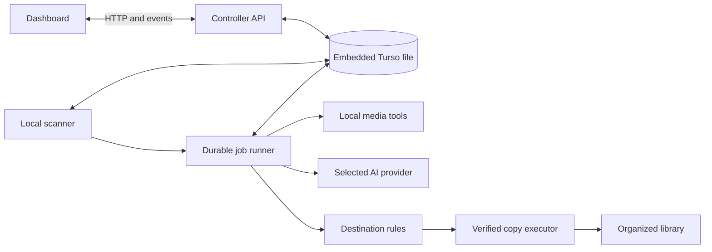
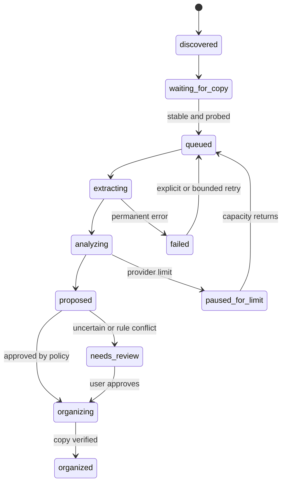

# ShotHarbor — Technical Specification

> Engineering design draft · 10 October 2026  
> Status: proposed architecture, not an implemented product

ShotHarbor indexes and organizes photo and video footage from cameras, drones, phones, and later remote sources. This document defines the components, data contracts, processing rules, and engineering checks needed to build it. The [README](README.md) explains the product and roadmap; this file is the implementation reference.

## 1. Scope and design rules

The first release runs on one macOS computer. A local Node.js service scans one inbox, owns an embedded database, processes media, serves a dashboard, and copies approved assets into an organized library. The service may send **selected, resized frames and metadata** to an authorized online AI provider. It does not send entire original videos by default.

Core invariants:

1. **One database owner.** Only the controller process writes the embedded database. A future Windows worker communicates through the controller API.
2. **Originals survive.** Initial organization copies files. No automatic deletion, replacement, or move of source originals.
3. **AI cannot perform file operations.** A provider returns observations and optional categories. Deterministic application code chooses and validates destinations.
4. **Every stage is durable and repeatable.** A restart must not lose an asset, duplicate a copy, or require reanalysis of unchanged media.
5. **Paths belong to sources.** A path is never treated as globally unique; an asset location is identified by its source and source-relative key.
6. **Human corrections win.** Reanalysis must not erase approved tags, categories, or destination corrections.
7. **Network use is explicit.** The dashboard shows which provider receives frames, and the queue pauses cleanly at a subscription limit.

### Release boundary

**Local MVP:** one local inbox, one organized library, image and video indexing, one validated provider, basic search, source tree, dashboard, review, and safe copies. **Later:** second provider, multiple sources, remote workers, cloud connectors, and compression. These later components influence interfaces now but do not need working implementations in the MVP.

## 2. Proposed technology stack

| Component | Proposed implementation | Engineering note |
| --- | --- | --- |
| Runtime and language | Current supported Node.js LTS and TypeScript with strict mode | Do not write custom decoding in JavaScript. |
| API/controller | Fastify or an equivalent typed HTTP server | Bind to loopback by default; keep HTTP contracts separate from domain logic. |
| Dashboard | React and Vite with TypeScript | A local browser UI; no hosted dashboard is required. |
| Validation | Zod or equivalent runtime schemas | Validate configuration, API inputs, and AI output. |
| Embedded database | Turso Database native Node package, `@tursodatabase/database` | Rust implementation, local database file, no Turso Cloud requirement. Validate required SQL and backup behavior before committing the schema. |
| Media tools | `ffprobe` and `ffmpeg` child processes | Use argument arrays, timeouts, concurrency limits, and checked exit codes. |
| Scene changes | A local detector behind a `SceneDetector` interface | Start by testing FFmpeg scene metrics; compare against PySceneDetect only if needed. |
| Hashing | Node crypto streaming SHA-256 | Hash after a file is stable; avoid loading whole media into memory. |
| UI updates | Server-sent events, with polling fallback | Push job counts and progress; normal API reads remain available. |
| Tests | Node test runner or Vitest plus disposable media fixtures | Prioritize integration tests at filesystem and restart boundaries. |

Turso's [native JavaScript package](https://github.com/tursodatabase/turso/blob/main/bindings/javascript/packages/native/README.md) supports a local file and TypeScript. It has not reached 1.0 and SQLite compatibility is incomplete; keep SQL behind repositories, run compatibility tests for every feature used, and maintain restorable backups. Do not assume SQLite FTS extensions work until tested.

### Suggested package layout

```text
apps/
  controller/       # scanner, scheduler, jobs, HTTP API, local worker
  dashboard/        # browser UI
packages/
  domain/           # types, state transitions, destination rules
  database/         # migrations, repositories, backup/restore
  media/            # ffprobe/ffmpeg, image prep, sampling, scene detection
  providers/        # provider contract, auth adapters, result validation
  source-local/     # first SourceAdapter
  shared/           # API schemas and event types
```

This is a module boundary, not a requirement to deploy several processes. The MVP can run as one controller process plus a browser UI.

## 3. System boundaries



The scanner records facts about available files. The runner transforms media into observations and proposals. The API exposes state and accepts user decisions. The copy executor is the only component allowed to write organized media.

## 4. Domain model and persistence

Use migrations from day one. Store UTC timestamps as an unambiguous integer or ISO text format consistently. Store byte counts as integers. Keep the database outside watched and organized folders to prevent recursive imports.

| Entity | Essential fields | Purpose |
| --- | --- | --- |
| `sources` | `id`, `kind`, `name`, `root_uri`, `enabled`, `last_scan_at`, `availability` | Each inbox, library, drive, or later remote source. |
| `locations` | `id`, `source_id`, `relative_key`, `display_path`, `size_bytes`, `mtime`, `fingerprint`, `content_sha256`, `state`, `last_seen_at` | Source-scoped file identity and latest observed file facts. Unique on `(source_id, relative_key)`. |
| `assets` | `id`, `media_kind`, `mime`, `width`, `height`, `duration_ms`, `captured_at`, `camera_make`, `camera_model`, `primary_location_id`, `created_at` | Logical media record. Several locations may point to the same content without collapsing their paths. |
| `jobs` | `id`, `asset_id`, `kind`, `state`, `attempt`, `next_run_at`, `lease_owner`, `lease_until`, `error_code`, `created_at`, `updated_at` | Durable work and retry control. Unique active job per asset and operation. |
| `frame_samples` | `id`, `asset_id`, `timestamp_ms`, `reason`, `perceptual_hash`, `preview_key`, `width`, `height` | Selected frames and the reason each was chosen. |
| `analyses` | `id`, `asset_id`, `provider`, `model`, `status`, `raw_result_key`, `description`, `suggested_category`, `uncertainty`, `created_at` | Versioned provider results. Redact secrets and avoid retaining full image payloads. |
| `tags` / `asset_tags` | tag name; asset ID, origin, confidence, active | Searchable AI and human tags. Preserve human overrides. |
| `proposals` | `id`, `asset_id`, `rule_version`, `destination_key`, `reason`, `state`, `review_reason` | Explicit organization decision before any copy. |
| `file_operations` | `id`, `asset_id`, `kind`, `source_location_id`, `destination_key`, `state`, `size_bytes`, `checksum`, `started_at`, `finished_at` | Audit and recovery record for each copy or later move. |
| `folder_index` | `source_id`, `relative_key`, `parent_key`, `kind`, `last_seen_scan_id` | Source tree without recursively reading the filesystem on every UI click. |
| `scan_runs` | `id`, `source_id`, `started_at`, `finished_at`, `state`, `seen_count`, `error` | Freshness and offline-source reporting. |

Add indexes for job state and due time, source and relative key, content hash, asset capture date, and tag lookup. Search should initially use a small normalized term index or verified supported SQL search; an FTS extension is an optimization only after a compatibility test. Store preview images in an application cache directory and their keys in the database. Do not put large frame blobs in SQL rows.

### Identity and duplicates

- On discovery, identify a location by `(source_id, relative_key)`. Compare size and modification time for a cheap change signal.
- After stability, stream a SHA-256 hash. Equal hash and size are strong evidence for duplicate content; retain each distinct location.
- Use a unique asset identity independent of filename. A renamed file should be reconcilable with a prior hash rather than necessarily reanalyzed.
- Distinguish **same file rediscovered**, **same bytes at a new path**, and **visually similar but different bytes**. Only the first two can skip analysis automatically in the MVP.
- Record the analysis version, provider, sampling policy, and prompt version so a changed policy can intentionally trigger reanalysis.

## 5. Scanner and stable-file detection

Run a configurable periodic scan; five minutes is a reasonable default for testing, with manual rescan in the dashboard. Avoid depending solely on filesystem notifications, which can be incomplete for removable or network volumes.

For each configured source:

1. Confirm the root is accessible and record a `scan_run`; show an unavailable state without deleting previously indexed files.
2. Walk within the configured root, honoring exclusions such as cache, destination library, hidden temporary files, and symlink policy. Never follow a symlink outside an allowed root.
3. Register supported candidates by path and stat data. Do not trust extensions as proof of media type.
4. Mark a file stable only after the size and modification time match across at least two scans or checks separated by a configurable quiet period. Recheck immediately before media probing and before copy.
5. Probe content, hash it, and queue work transactionally. Repeated scans must not create duplicate active jobs.
6. Reconcile missing files only after a complete successful scan. Mark them missing; do not silently delete history.

The scanner must tolerate permission errors, disappearing files, long paths, and partial card transfers. Report per-file failures rather than failing the whole scan.

## 6. Media inspection and sampling

Use `ffprobe` to read video streams, duration, dimensions, rotation, codec, and timestamps. Extract image metadata and orientation using a supported image metadata reader. Preserve original capture time and its provenance; filesystem modification time is a fallback, not necessarily the shoot date.

### Video frame selection

The following is a **starting heuristic to measure**, not a quality guarantee:

```text
budget(duration_seconds) = clamp(
  min = 4,
  max = 36,
  value = ceil(4 + 4 * log2(max(1, duration_seconds / 30)))
)
```

At 30 seconds it selects about four frames; at five minutes about 18; at an hour about 32. The configuration controls minimum, maximum, image size, and provider batch size.

Selection procedure:

1. Place baseline timestamps evenly across the full duration, avoiding only the first and last few milliseconds.
2. Run local scene detection at reduced resolution. Add candidates near strong cuts; do not rely on cuts alone because continuous camera and drone takes can change subject gradually.
3. Score candidates for coverage, scene strength, blur, and near-duplicate similarity. Deduplicate with a perceptual hash threshold validated against real footage.
4. Keep a small guaranteed share of uniform timestamps so scene candidates cannot consume the whole budget. Cap the final count and record `reason` for each timestamp.
5. Extract and resize selected frames locally. Respect rotation and pixel aspect ratio; encode as a provider-supported image type.
6. For a long clip, send bounded batches with timestamps, summarize batch observations, then merge them into one asset-level result. Never treat one frame as proof of an event lasting the full video.

Temporary images live in a job-scoped cache and are cleaned after success or bounded retention on failure. The dashboard may keep separate low-resolution previews. Set limits for decoder processes, RAM, disk cache, input duration, and provider concurrency.

## 7. AI provider contract

The app needs **provider adapters**, not a general-purpose autonomous filesystem agent. The selected provider receives media evidence and returns structured observations. A schema validator rejects malformed output before it reaches the database or rule engine.

```ts
type VisualObservation = {
  summary: string;
  tags: Array<{ name: string; confidence: number }>;
  visibleElements: string[];
  suggestedCategory?: string;
  uncertaintyNotes: string[];
};

interface AnalysisProvider {
  id: string;
  checkAvailability(): Promise<{ available: boolean; reason?: string }>;
  analyze(input: {
    assetId: string;
    frames: Array<{ timestampMs: number; imagePath: string }>;
    context: { mediaKind: "photo" | "video"; durationMs?: number };
  }): Promise<VisualObservation>;
}
```

Normalize tags (case, spelling, length, duplicates) and keep confidence as a model estimate, not a calibrated probability. Never let model text become an absolute destination path. Treat text found inside footage as untrusted content; it cannot override application instructions or authorize a file operation.

### Subscription-backed integrations are a validation gate

The [OpenAI Sign in with ChatGPT guide](https://developers.openai.com/siwc/quickstart) describes eligible ChatGPT plan usage in open-source apps and selected private clients. Its [preview limitations](https://developers.openai.com/siwc/token-sharing-open-source/preview-limitations) include image inputs for supported models but not direct audio or video; requests have specific constraints. **ShotHarbor uses a noncommercial source-available license, so eligibility for this flow must be confirmed before treating ChatGPT plan use as a supported product feature.** Do not substitute copied browser cookies, hidden endpoints, or a personal API key without an explicit alternative billing path.

Anthropic currently documents [Claude Agent SDK usage with Claude plans](https://support.claude.com/en/articles/15036540-use-the-claude-agent-sdk-with-your-claude-plan), subject to plan limits. Validate image attachment behavior, unattended execution, redistribution terms, and rate-limit recovery with a working prototype. Both integrations should expose an explicit authorization state and a disconnect action. Keep credentials in the OS keychain or a comparably secure store, outside the media database and logs.

If either subscription path is unsupported for this app, keep the adapter disabled and document a supported alternative. Do not make the local MVP dependent on both providers passing the gate.

## 8. Durable job state machine



Persist the state transition and relevant output in one database transaction. A worker claims a job with a lease and heartbeat; after a crash, an expired lease makes the job eligible again. Each stage checks whether its output already exists and is valid before repeating expensive work. Retry transient failures with capped exponential backoff and jitter. Permanent errors and review decisions require human action. The dashboard exposes each state, attempt count, last error, and next retry time.

## 9. Rule engine, review, and safe copy

Folder rules accept trusted fields such as event/shoot label, capture date, camera, and approved category. The AI can suggest a category, but the rule engine maps it to a controlled value. Example destination: `<library>/<shoot>/<YYYY-MM-DD>/<camera>/<original-name>`.

Before creating a proposal, normalize path segments, reject traversal and reserved names, enforce the destination root, and resolve filename collisions deterministically. A low-confidence category, conflicting metadata, unsafe path, or duplicate candidate enters review. The UI shows the source, selected frames, model observation, proposed path, reason for review, and editable tags/category/destination.

For an approved copy:

1. Record a pending `file_operation` with a unique operation key.
2. Confirm the source still matches the indexed size and hash; if changed, return to discovery.
3. Copy to a temporary file **inside the destination filesystem**; stream bytes and compute or verify checksum.
4. Flush, atomically rename the temporary file to its final path when supported, then record completion and the new location.
5. On restart, reconcile pending operations by inspecting temporary and final paths before retrying. Never overwrite a different file silently.

The MVP's undo removes only a ShotHarbor-created copy after verifying its identity; it never deletes the source original. Later move or compression workflows require separate, explicit policies and version records.

## 10. Dashboard and local API

Bind to `127.0.0.1` by default. If remote dashboard access is added, require authentication and TLS. Keep media paths and credentials out of public logs.

| Endpoint or event | Purpose |
| --- | --- |
| `GET /api/overview` | Counts by state, media kind, source, provider, and measured storage bytes. |
| `GET /api/assets` | Paginated search and filters: text, tag, source, type, date, state. |
| `GET /api/assets/:id` | Metadata, locations, frames, analysis versions, tags, proposal, operations. |
| `GET /api/sources` and `/api/sources/:id/tree` | Roots, freshness, availability, paginated folder children. |
| `GET /api/jobs` | Active, paused, failed, and review work. |
| `POST /api/assets/:id/review` | Approve or correct a proposal with an expected revision to prevent stale writes. |
| `POST /api/sources/:id/scan` | Manual rescan. |
| `GET /api/events` | Server-sent job, scan, and storage summary updates. |

Use a local indexed search over filenames, AI descriptions, and active tags. A search request does not call the AI provider. Show source, path, thumbnail, tags, and processing state in results. The tree reads `folder_index`, not a fresh recursive scan on every expand. Storage reporting separates originals, copies, previews, and later compressed derivatives; don't double-count multiple locations as unique media without labeling the distinction.

## 11. Configuration and operation

Store non-secret settings in an application configuration file: inbox and library roots, scan interval, file exclusions, frame budget, image size, job concurrency, provider choice, and auto-approval thresholds. Validate at startup and reject an inbox nested inside the destination library or vice versa. Store secrets separately in secure credential storage.

At startup: acquire a single-controller lock, open and migrate the database, verify FFmpeg availability, recover expired jobs and pending file operations, then start the scanner and local API. A failed media tool should degrade processing visibly, not corrupt the index. Provide a database backup command and a restore drill before large imports; back up a consistent database snapshot, not just an arbitrary copy of an open file.

Logs need structured event names and asset/job IDs, with no access tokens, image payloads, or unnecessary full paths. The UI should show actionable error categories and allow retry. Track scan duration, queue age, processing duration, provider pauses, cache bytes, and database size.

## 12. Future extension contracts

### Source adapters

```ts
interface SourceAdapter {
  kind: string;
  listChildren(parentKey: string, cursor?: string): Promise<{
    entries: Array<{ key: string; kind: "file" | "folder"; sizeBytes?: number }>;
    nextCursor?: string;
  }>;
  stat(key: string): Promise<{ sizeBytes: number; version?: string; modifiedAt?: string }>;
  openRead(key: string): Promise<NodeJS.ReadableStream>;
  availability(): Promise<{ online: boolean; checkedAt: string }>;
}
```

Local folders implement this first. Cloud and another-machine adapters should map provider IDs to stable source-scoped keys, paginate listings, record last successful scan, and display stale data when offline. The controller continues to own the database and file decisions.

### Remote processing worker

A Windows worker may request bounded jobs over an authenticated controller API, receive only authorized media or selected frames, and return results plus hashes. Use short-lived job leases, idempotent result submission, and explicit capability scopes. Do not mount or share the embedded database file across machines. Keep provider credentials on the controller unless a separately reviewed worker credential flow is needed.

### Compression

Create a new `asset_version` or derived-file record. Capture codec, settings, quality measurements, byte size, checksum, and source version. Preview before replacement or archival. Storage savings are measured bytes; monetary estimates require user-supplied pricing and are labeled as estimates.

## 13. Engineering sequence and verification gates

1. **Feasibility spikes:** run Turso's native package on the M2 Pro; verify migrations, transactions, indexes, backups, and restore. Probe the actual media sample set. Confirm at least one supported provider authorization and image analysis path under ShotHarbor's license.
2. **Vertical slice:** scan one photo and one video, wait for stability, probe, hash, sample frames, analyze, store tags, propose a path, approve, copy, and find the asset in the dashboard.
3. **Durability:** kill the app during each stage and during a copy; restart and confirm one final result, no lost job, and no original deletion.
4. **Scale and quality:** import representative long and short clips. Measure frame usefulness, repeated work, queue throughput, cache growth, storage totals, and provider-limit behavior. Tune the frame budget using footage labels rather than intuition alone.
5. **Daily use:** add the second provider only after its prototype passes; add review, corrections, retries, audit/undo, and storage breakdowns.
6. **Extensions:** multiple local sources, then one remote source and an authenticated worker, then compression as a versioned opt-in operation.

Minimum automated checks should cover scan idempotency, incomplete transfers, changed files, duplicate hashes, sampling coverage, output schema rejection, path traversal and collision handling, interrupted copy recovery, migration/restore, human tag preservation, and search/tree consistency. Use fixtures with permission to redistribute; keep private test footage outside the public repository.

## 14. Open technical decisions

- Does the selected Turso release support every required transaction, index, and backup operation on macOS and Windows? Record the tested version and fallback plan.
- Which image metadata reader best handles iPhone HEIC, camera RAW previews, EXIF orientation, and capture timestamps? Scope formats from actual sample media.
- What scene threshold and deduplication threshold work for drone pans, low-light footage, and edited clips?
- Is ChatGPT plan usage available to a **PolyForm Noncommercial, source-available** project under current OpenAI terms? Confirm directly before advertising it as supported.
- Does the chosen Claude Agent SDK flow support the intended image payloads and unattended queue behavior under the user's plan?
- What confidence and review policy is acceptable after measuring false folder placements on real footage?

These questions are implementation gates. They should be resolved with small prototypes and recorded results, rather than hidden behind a broad architectural assumption.

